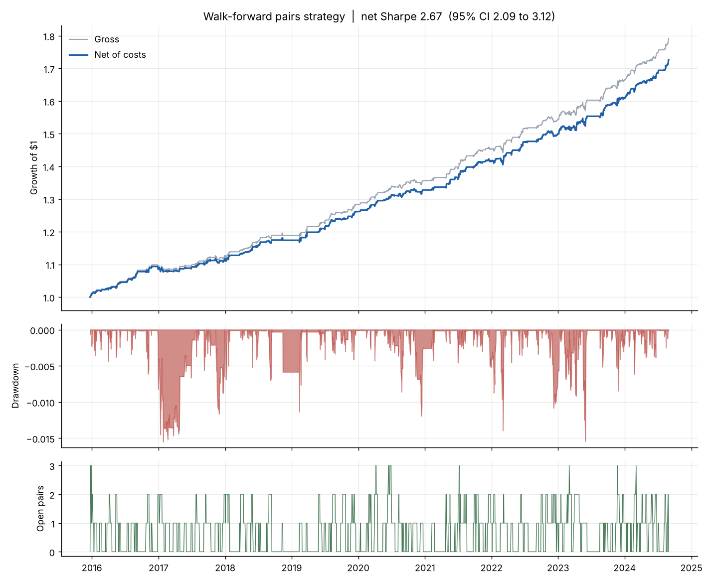

# Backtest report

| Metric | Net | Gross |
|---|---|---|
| CAGR | 0.063 | 0.067 |
| AnnVol | 0.023 | 0.023 |
| Sharpe | 2.669 | 2.847 |
| Sharpe95_lo | 2.093 | 2.261 |
| Sharpe95_hi | 3.123 | 3.306 |
| PSR(SR>0) | 1.000 | 1.000 |
| Sortino | 4.958 | 5.362 |
| MaxDD | -0.015 | -0.015 |
| Calmar | 4.036 | 4.356 |
| HitRate(days) | 0.548 | 0.591 |
| AnnTurnover | 11.987 | nan |

Trades: 170, win rate 90.0%, avg return 0.96%, avg hold 8.7 days

